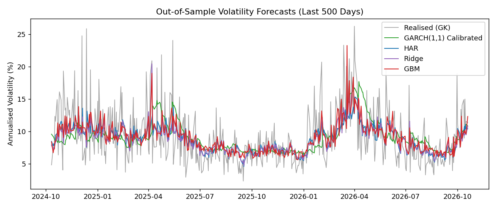
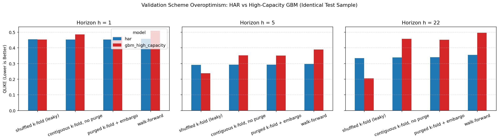

# vol-forecaster: leakage-safe volatility forecasting

Predicting market risk is fundamental to portfolio construction, derivative pricing, and position sizing, yet standard machine learning cross-validation frequently inflates out-of-sample performance through lookahead bias and serial correlation leakage. `vol-forecaster` provides an expanding-window walk-forward forecasting pipeline that guards against information leakage when predicting next-day and multi-day volatility from daily OHLC data. It benchmarks econometric baselines (HAR, GARCH, GJR-GARCH) against regularized and non-linear machine learning models (Ridge, HistGradientBoosting), evaluates forecasts with robust loss metrics (QLIKE) and statistical significance testing (Diebold-Mariano with Newey-West variance), and demonstrates through controlled experiments why ordinary cross-validation gives misleading results on time-ordered data.

---

## How to Reproduce

All numbers and figures in this repository are generated from real market data via the documented commands below.

### 1. Installation
```bash
pip install -r requirements.txt
```

### 2. Run Test Suite
```bash
pytest -v
```

### 3. Run Walk-Forward Experiments on Real Data
To run walk-forward forecasting across horizons $h \in \{1, 5, 22\}$ on the S&P 500 (`^GSPC`) and Nifty 50 (`^NSEI`):
```bash
python -u -m volfc.run --config configs/sp500.yaml
python -u -m volfc.run --config configs/nsei.yaml
```
Outputs are written to:
- `results/summary.csv`: Master scorecard across tickers and horizons
- `results/pairwise_dm.csv`: Pairwise Diebold-Mariano tests with Holm-Bonferroni correction
- `results/regimes.csv`: High-vol vs Low-vol breakdown (past data only) and Covid-19 (2020)
- `results/mincer_zarnowitz.csv`: Mincer-Zarnowitz diagnostic regressions per model
- `results/vol_targeting_metrics.csv`: Calibrated volatility targeting strategy results across 0, 2, 5, 10 bps

### 4. Run the Leakage Demonstration
To demonstrate how validation schemes distort performance across horizons $h \in \{1, 5, 22\}$ on identical test samples:
```bash
python -u leakage_demo.py --source yfinance --ticker ^GSPC --horizons 1 5 22 --step 84
```
Outputs are written to `results/leakage_demo.csv` and `results/leakage_demo.png`.

---

## Key Results

The tables below are copied directly from `results/summary.csv`, produced by running walk-forward validation (initial training window = 1,000 days, refit every 21 days) on daily historical data from 2010 to October 2026.

### S&P 500 (`^GSPC`) Out-of-Sample Performance

| Horizon ($h$) | Model | QLIKE Loss (lower is better) | Log-Var MSE | Log-Var $R^2$ | DM Stat vs HAR | DM $p$-value vs HAR | 95% Bootstrap CI vs HAR | $N_{\text{OOS}}$ |
|---|---|---|---|---|---|---|---|---|
| **$h=1$** | **ridge** | 0.4450 | 0.6936 | 0.5099 | -0.9162 | 0.3596 | [-0.0359, +0.0166] | 3159 |
| $h=1$ | **gbm** | 0.4515 | 0.7093 | 0.4988 | -0.3262 | 0.7443 | [-0.0324, +0.0305] | 3159 |
| $h=1$ | **har** | 0.4566 | 0.7175 | 0.4930 | — | — | — | 3159 |
| $h=1$ | **roll22** | 0.5031 | 1.0507 | 0.2576 | +3.4158 | 0.0006 | [+0.0208, +0.0737] | 3159 |
| $h=1$ | **gjr_garch** | 0.5303 | 0.8363 | 0.4091 | +2.6354 | 0.0084 | [+0.0255, +0.1378] | 3159 |
| $h=1$ | **garch** | 0.5677 | 0.8936 | 0.3686 | +5.0431 | 0.0000 | [+0.0724, +0.1578] | 3159 |
| $h=1$ | **garch_raw** | 0.5798 | 1.8662 | -0.3187 | +5.2820 | 0.0000 | [+0.0799, +0.1694] | 3159 |
| $h=1$ | **naive** | 0.6803 | 0.9930 | 0.2984 | +9.2986 | 0.0000 | [+0.1787, +0.2710] | 3159 |
| **$h=5$** | **ridge** | 0.2898 | 0.4409 | 0.5521 | -1.3187 | 0.1874 | [-0.0176, +0.0026] | 3155 |
| $h=5$ | **har** | 0.2970 | 0.4615 | 0.5311 | — | — | — | 3155 |
| $h=5$ | **gbm** | 0.3101 | 0.4735 | 0.5189 | +1.1127 | 0.2659 | [-0.0071, +0.0397] | 3155 |
| $h=5$ | **gjr_garch** | 0.3623 | 0.5501 | 0.4411 | +3.2176 | 0.0013 | [+0.0271, +0.1069] | 3155 |
| $h=5$ | **roll22** | 0.3690 | 0.6371 | 0.3527 | +5.2231 | 0.0000 | [+0.0452, +0.1011] | 3155 |
| $h=5$ | **garch** | 0.3951 | 0.5885 | 0.4021 | +4.0318 | 0.0001 | [+0.0560, +0.1467] | 3155 |
| $h=5$ | **garch_raw** | 0.4383 | 1.2486 | -0.2686 | +5.2821 | 0.0000 | [+0.0877, +0.1900] | 3155 |
| $h=5$ | **naive** | 0.7123 | 0.8825 | 0.1034 | +13.4020 | 0.0000 | [+0.3586, +0.4757] | 3155 |
| **$h=22$** | **har** | 0.3556 | 0.4590 | 0.3892 | — | — | — | 3138 |
| $h=22$ | **ridge** | 0.3871 | 0.4664 | 0.3794 | +1.8306 | 0.0672 | [+0.0041, +0.0709] | 3138 |
| $h=22$ | **garch** | 0.4025 | 0.5526 | 0.2647 | +2.4615 | 0.0139 | [+0.0096, +0.0881] | 3138 |
| $h=22$ | **gjr_garch** | 0.4042 | 0.5514 | 0.2663 | +2.6159 | 0.0089 | [+0.0145, +0.0869] | 3138 |
| $h=22$ | **gbm** | 0.4208 | 0.5139 | 0.3162 | +2.5241 | 0.0116 | [+0.0201, +0.1197] | 3138 |
| $h=22$ | **garch_raw** | 0.4307 | 1.1792 | -0.5691 | +1.0868 | 0.2772 | [-0.0794, +0.1906] | 3138 |
| $h=22$ | **roll22** | 0.4641 | 0.6272 | 0.1655 | +3.1901 | 0.0014 | [+0.0492, +0.1907] | 3138 |
| $h=22$ | **naive** | 1.1864 | 1.1605 | -0.5442 | +8.1596 | 0.0000 | [+0.6648, +1.0767] | 3138 |

### Nifty 50 (`^NSEI`) Out-of-Sample Performance

| Horizon ($h$) | Model | QLIKE Loss (lower is better) | Log-Var MSE | Log-Var $R^2$ | DM Stat vs HAR | DM $p$-value vs HAR | 95% Bootstrap CI vs HAR | $N_{\text{OOS}}$ |
|---|---|---|---|---|---|---|---|---|
| **$h=1$** | **ridge** | 0.3670 | 0.5564 | 0.3655 | -1.2888 | 0.1976 | [-0.0707, -0.0030] | 3060 |
| $h=1$ | **har** | 0.3931 | 0.5869 | 0.3308 | — | — | — | 3060 |
| $h=1$ | **roll22** | 0.4053 | 0.7481 | 0.1469 | +1.2467 | 0.2126 | [-0.0078, +0.0294] | 3060 |
| $h=1$ | **gjr_garch** | 0.4215 | 0.6607 | 0.2466 | +1.2484 | 0.2120 | [-0.0197, +0.0607] | 3060 |
| $h=1$ | **gbm** | 0.4316 | 0.5959 | 0.3205 | +1.1902 | 0.2340 | [-0.0086, +0.1149] | 3060 |
| $h=1$ | **garch** | 0.4496 | 0.6623 | 0.2448 | +3.4812 | 0.0005 | [+0.0285, +0.0913] | 3060 |
| $h=1$ | **garch_raw** | 0.4965 | 1.4204 | -0.6197 | +4.1963 | 0.0000 | [+0.0596, +0.1519] | 3060 |
| $h=1$ | **naive** | 0.6108 | 0.8908 | -0.0158 | +7.3609 | 0.0000 | [+0.1589, +0.2724] | 3060 |
| **$h=5$** | **ridge** | 0.2083 | 0.3132 | 0.4446 | -1.8874 | 0.0592 | [-0.0185, -0.0026] | 3056 |
| $h=5$ | **har** | 0.2167 | 0.3274 | 0.4196 | — | — | — | 3056 |
| $h=5$ | **gjr_garch** | 0.2542 | 0.4131 | 0.2675 | +2.6085 | 0.0091 | [+0.0081, +0.0579] | 3056 |
| $h=5$ | **roll22** | 0.2571 | 0.4011 | 0.2888 | +3.3031 | 0.0010 | [+0.0159, +0.0615] | 3056 |
| $h=5$ | **garch** | 0.2673 | 0.4023 | 0.2866 | +3.2371 | 0.0012 | [+0.0208, +0.0814] | 3056 |
| $h=5$ | **gbm** | 0.2770 | 0.3645 | 0.3537 | +1.3957 | 0.1629 | [-0.0013, +0.1650] | 3056 |
| $h=5$ | **garch_raw** | 0.3497 | 0.9077 | -0.6094 | +5.5705 | 0.0000 | [+0.0835, +0.1767] | 3056 |
| $h=5$ | **naive** | 0.5452 | 0.7221 | -0.2803 | +11.1812 | 0.0000 | [+0.2731, +0.3839] | 3056 |
| **$h=22$** | **ridge** | 0.2387 | 0.3104 | 0.2805 | -0.6722 | 0.5015 | [-0.0450, +0.0092] | 3039 |
| $h=22$ | **har** | 0.2488 | 0.3049 | 0.2932 | — | — | — | 3039 |
| $h=22$ | **gjr_garch** | 0.2647 | 0.3859 | 0.1056 | +0.7577 | 0.4487 | [-0.0306, +0.0464] | 3039 |
| $h=22$ | **garch** | 0.2848 | 0.3738 | 0.1335 | +2.9734 | 0.0030 | [+0.0141, +0.0600] | 3039 |
| $h=22$ | **gbm** | 0.2926 | 0.3476 | 0.1942 | +2.0279 | 0.0427 | [+0.0099, +0.0900] | 3039 |
| $h=22$ | **roll22** | 0.3419 | 0.3698 | 0.1428 | +1.9777 | 0.0481 | [+0.0202, +0.1949] | 3039 |
| $h=22$ | **garch_raw** | 0.3575 | 0.8438 | -0.9559 | +1.8480 | 0.0647 | [-0.0234, +0.1958] | 3039 |
| $h=22$ | **naive** | 0.6977 | 0.7984 | -0.8506 | +9.6655 | 0.0000 | [+0.3655, +0.5446] | 3039 |

> [!NOTE]
> **Bootstrap CI vs Diebold-Mariano Disagreements**:
> Block bootstrap intervals use a block length of $B = \max(h, 20) = 20$ (and $22$ for $h=22$). In 39 of 42 comparisons, the bootstrap CI and DM test agree. They disagree in 3 borderline cases involving `ridge`:
> 1. `^GSPC` ($h=22$): DM $p = 0.0672$ (not significant at 5% level under Newey-West Bartlett kernel), whereas the bootstrap CI $[+0.0041, +0.0709]$ barely excludes zero.
> 2. `^NSEI` ($h=1$): DM $p = 0.1976$ (no evidence of difference under DM), whereas the bootstrap CI $[-0.0707, -0.0030]$ barely excludes zero on the negative side.
> 3. `^NSEI` ($h=5$): DM $p = 0.0592$ (borderline non-significant), whereas the bootstrap CI $[-0.0185, -0.0026]$ excludes zero.
> This divergence occurs because DM relies on an asymptotic Student-$t$ distribution with spectral density estimation, while the block bootstrap resamples empirical blocks without parametric normality assumptions.

---

## Key Figures

### 1. Out-of-Sample Volatility Forecasts vs Realized Volatility
Comparison of realized Garman-Klass volatility with out-of-sample walk-forward forecasts (last 500 trading days):



### 2. Validation Scheme Overoptimism (The Leakage Demo)
Comparison of QLIKE scores for a high-capacity model (HistGradientBoosting) versus the linear HAR baseline across four validation schemes evaluated on the identical out-of-sample sample ($N \approx 3,150$):



| Horizon | Validation Scheme | High-Capacity GBM | HAR Baseline | Empirical Finding |
|---|---|---|---|---|
| **$h=1$** | Shuffled $k$-fold (leaky) | 0.4526 | 0.4538 | Minimal label overlap; shuffling impact is subtle at $h=1$. |
| $h=1$ | Contiguous $k$-fold, no purge | 0.4845 | 0.4530 | Preserving contiguous blocks prevents feature interpolation. |
| $h=1$ | Purged $k$-fold + embargo | 0.4696 | 0.4524 | Purge difference vs contiguous is minimal ($\Delta \approx 0.015$). |
| $h=1$ | Walk-forward | 0.5082 | 0.4565 | True out-of-sample ordering: HAR outperforms flexible GBM. |
| **$h=5$** | Shuffled $k$-fold (leaky) | **0.2376** | 0.2904 | Multi-day label overlap allows tree model to memorize neighbors. |
| $h=5$ | Contiguous $k$-fold, no purge | 0.3518 | 0.2916 | Artificial advantage collapses when contiguous blocks are used. |
| $h=5$ | Purged $k$-fold + embargo | 0.3507 | 0.2920 | Purging overlapping boundaries adds a small safeguard ($\Delta \approx 0.001$). |
| $h=5$ | Walk-forward | 0.3881 | **0.2962** | HAR strongly dominates out-of-sample. |
| **$h=22$** | Shuffled $k$-fold (leaky) | **0.2051** | 0.3337 | Extreme artificial superiority due to 22-day label sharing. |
| $h=22$ | Contiguous $k$-fold, no purge | 0.4563 | 0.3386 | Enforcing contiguous blocks sharply degrades flexible model. |
| $h=22$ | Purged $k$-fold + embargo | 0.4507 | 0.3403 | Purge and embargo provide minor boundary refinement ($\Delta \approx 0.006$). |
| $h=22$ | Walk-forward | 0.4948 | **0.3543** | In realistic deployment, HAR is substantially superior. |

> [!IMPORTANT]
> **Mechanics of the Leak**:
> The primary source of leakage under standard cross-validation is **random shuffling**, which scatters immediate neighbors of test rows into the training set, allowing high-capacity models to interpolate between adjacent days. Switching from shuffled to **contiguous blocks** eliminates this feature interpolation. Purging and embargoing provide an extra safeguard against boundary overlap; at $h=5$, contiguous vs purged k-fold QLIKE differs by only $\approx 0.001$ ($0.3518$ vs $0.3507$).

---

## Practical Application: Volatility Targeting Backtest

A standard use case for volatility forecasts is risk-targeted portfolio sizing:
$$\text{position}_t = \min\left(\text{max\_leverage}, \frac{\sigma_{\text{target}}}{\hat{\sigma}_{c2c, t-1}}\right)$$
where $\text{position}_t$ is sized at the close of day $t-1$ using only information available up to that close, and earns the day $t$ asset return net of transaction costs.

To correct for the $\approx 1.87\times$ ratio between close-to-close return variance and intraday Garman-Klass variance, model forecasts are calibrated to close-to-close variance inside each expanding training window using strictly past data.

Target annual volatility: **15.0%**, Max leverage: **2.0x**. Results below are copied from `results/vol_targeting_metrics_GSPC.csv` across transaction cost assumptions (0, 2, 5, 10 bps):

| Model | Cost (bps) | Realized Vol | Sharpe Ratio | Max Drawdown | Annual Turnover |
|---|---|---|---|---|---|
| **Buy & Hold** | 0 | 17.29% | 0.7425 | 33.92% | 0.00x |
| **roll22** | 5 | 15.39% | 0.7151 | 21.79% | 6.61x |
| **har** | 5 | 14.42% | 0.6813 | 22.70% | 31.74x |
| **gjr_garch** | 5 | 15.80% | 0.6775 | 23.50% | 18.77x |
| **garch** | 5 | 15.65% | 0.6722 | 23.13% | 17.96x |
| **gbm** | 5 | 14.71% | 0.6015 | 23.21% | 41.67x |
| **ridge** | 5 | 15.72% | 0.6046 | 25.56% | 39.09x |
| **naive** | 5 | 16.75% | 0.5463 | 31.04% | 85.65x |

*Finding:* Calibrated volatility targeting controls portfolio risk close to the 15.0% target (realized vol 14.4%–15.8%) and mitigates peak-to-trough drawdowns (e.g. HAR max drawdown 22.70% vs Buy & Hold 33.92%), without claiming excess return.

---

## Limitations

1. **Daily OHLC Only**: The pipeline uses daily OHLC range estimators. High-frequency tick or 5-minute intraday realized variance would provide a cleaner ground truth.
2. **Fixed Hyper-parameters**: Model hyper-parameters (such as tree depth and regularization) are fixed in advance rather than tuned dynamically. Any future hyper-parameter optimization must be implemented via nested walk-forward loops inside the expanding training window.
3. **Garman-Klass Assumptions**: The Garman-Klass estimator assumes continuous Brownian motion and zero overnight gap. While far more efficient than squared close-to-close returns, it understates jump risk during market closures.
4. **Sample Regimes**: The evaluation covers 2010 to 2026, an era predominantly characterized by post-2008 quantitative easing, low interest rates, and brief recovery spikes (e.g. 2020), rather than a multi-decade inflationary regime.

---

## Glossary

- **Volatility**: The standard deviation of price changes over a specified horizon, representing the magnitude of price dispersion rather than direction.
- **Garman-Klass (GK) Estimator**: An intraday variance estimator combining High, Low, Open, and Close prices with up to eight times greater efficiency than close-to-close squared returns under continuous diffusion.
- **HAR (Heterogeneous Autoregressive Model)**: A linear regression model forecasting volatility from trailing daily (1-day), weekly (5-day), and monthly (22-day) historical realized volatility components.
- **QLIKE Loss**: A quasi-likelihood loss function defined on variance levels ($L(v, \hat{v}) = \frac{v}{\hat{v}} - \ln\frac{v}{\hat{v}} - 1$) that is strictly robust to proxy noise in volatility evaluation.
- **Diebold-Mariano (DM) Test**: An asymptotic hypothesis test comparing the predictive accuracy of two competing forecasts, adjusted for serial correlation via Newey-West spectral density estimation.
- **Purging**: Dropping training samples whose forward-looking label windows overlap with the test block to guard against label contamination.
- **Embargo**: Dropping training samples immediately following a test block to ensure backward-looking feature windows do not contain data from the test period.
